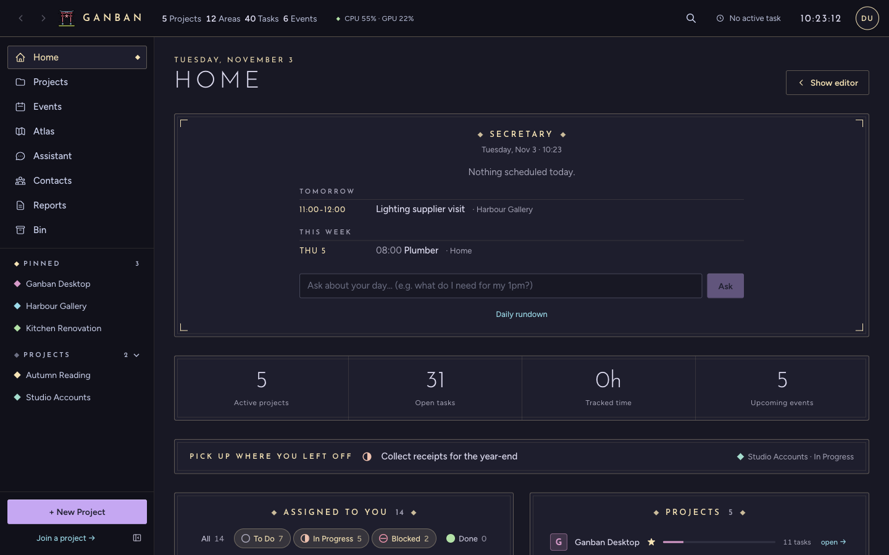

# Ganban

**Projects, tasks, a calendar and files for a family or a small team, on a computer you own, with an optional AI
assistant that runs locally.**

[](https://www.gnu.org/licenses/agpl-3.0)



Ganban is a desktop app for macOS, Windows and Linux. One computer is the host and keeps the data in a single SQLite
file. Phones, laptops and browsers on your private network connect to it. There's no cloud service, no account and no
telemetry.

## Download

Get the installer for your system from **[GitHub Releases](https://github.com/PeterK0/Ganban/releases)**:
a `.dmg` for macOS (Apple Silicon or Intel), an `.exe` or `.msi` for Windows, and an `.AppImage` or `.deb` for
Linux. The Android app is there too. From 1.0.2 on, these apps check the Releases page for new versions and
update themselves; **Settings → Updates** turns that off ([more](docs/user/UPDATES_AND_BACKUPS.md#updates)).

On a Mac, the first launch may say Ganban "is damaged" or "can't be opened": the apps aren't notarised by Apple yet.
Run `xattr -cr /Applications/Ganban.app` in Terminal once and open it again ([details](docs/user/GETTING_STARTED.md#macos)).

## Quick start

1. Install Ganban and open it. The first run creates your database and makes you its owner.
2. Make a project, then add a few tasks to its board.
3. Optional: install [Ollama](https://ollama.com) and pick a model in **Settings → AI Engines** to turn on the
   assistant.

The [getting-started guide](docs/user/GETTING_STARTED.md) walks through it, and the [FAQ](docs/user/FAQ.md)
answers the usual questions.

## What's in it

- **Projects, tasks and Kanban.** Group work into projects with areas. Each task has a status, a priority, a
  deadline, assignees, files and a timer. Turn on the Kanban tab to drag tasks across a board.
- **Home and the Secretary.** Home shows your pinned projects, what's due this week and today's events. The
  Secretary, an AI widget on the host owner's Home, writes a daily rundown of every active project and answers follow-up questions.
- **Calendar.** Month, week, day and agenda views. Events can repeat (daily, weekly, monthly, yearly), carry reminders and
  link to tasks.
- **Files and share links.** Every project has a Files tab. To send files to someone who doesn't use Ganban, make a
  share link: a download page with an expiry date, which you can revoke at any time.
- **Comments and updates.** Discuss a task in its comments. Post an update to the project's Comments board and tag
  it on several tasks at once.
- **The assistant and agents.** Each project has its own chat, grounded in its tasks and events. With tools on, the
  assistant can read project data. It never changes anything by itself: it proposes changes, and you approve or
  reject each one in the Activity view, which also keeps a record of everything that ran.
- **Atlas.** A searchable library of your documents, with AI overviews. It needs ragrat, which is coming later
  (see below).
- **Tabs.** Projects can turn on extra tabs from the **＋** in the tab bar: PDF Studio, Email, Kanban, Quizzes,
  the NATO Trainer and more. Tabs are compiled into the app, so there's nothing to install or audit. You can
  [build your own](docs/dev/TAB_TUTORIAL.md).
- **Phones.** Pair a phone with a QR code and it reaches your host over your private network, with the same
  projects and tasks.
- **Self-hosting.** The same server runs headless as `ganban-server`, on an always-on Mac or Linux box. See
  [self-hosting](docs/host/SELF_HOSTING.md).
- **In-app updates.** The host updates itself, then serves the new desktop and Android builds to its clients.
  Desktops download in the background and offer "Restart to update".
- **Themes.** Eight themes (four Catppuccin flavours, Dracula, Nord, Tokyo Night and Gruvbox), all in the Gilt
  style.

## AI is optional

Ganban works fully without any AI. The assistant and the Secretary need [Ollama](https://ollama.com), which runs
models on your own hardware.

**ragrat**, the document engine behind Atlas, the AI overviews and the assistant's document search, isn't public
yet. Without it those features say "not set up", and everything else works.

## Build from source

```bash
git clone https://github.com/PeterK0/Ganban.git && cd Ganban
npm install
npm run tauri dev
```

You need Node.js 20.19 or later, Rust (stable) and your platform's Tauri dependencies. [BUILDING.md](docs/dev/BUILDING.md)
lists them and covers the headless server, release builds, Android and iOS. [TESTING.md](docs/dev/TESTING.md)
covers the test suites.

## Documentation

The [docs map](docs/README.md) lists every doc. The main ones:

- **Using Ganban:** [getting started](docs/user/GETTING_STARTED.md), [FAQ](docs/user/FAQ.md),
  [phones and pairing](docs/user/PHONES_AND_PAIRING.md), [sharing](docs/user/SHARING.md),
  [updates and backups](docs/user/UPDATES_AND_BACKUPS.md), [troubleshooting](docs/user/TROUBLESHOOTING.md).
- **Hosting:** [self-hosting](docs/host/SELF_HOSTING.md), [environment variables](docs/host/ENV_REFERENCE.md),
  [bundling](docs/host/BUNDLING.md).
- **Contributing:** [building](docs/dev/BUILDING.md), [testing](docs/dev/TESTING.md),
  [tab tutorial](docs/dev/TAB_TUTORIAL.md), [tab spec](docs/dev/TAB_SPEC.md), [style guide](docs/dev/GILT.md).
- **Design:** [architecture](docs/design/Architecture.md) and the
  [decision records](docs/design/adr/).

## License

Ganban is free software under the [GNU Affero General Public License v3.0](https://www.gnu.org/licenses/agpl-3.0).
