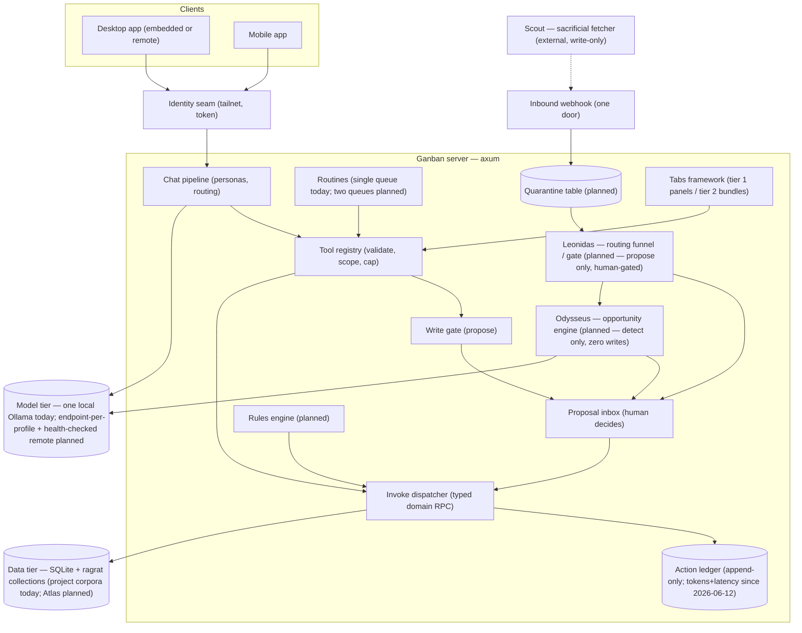
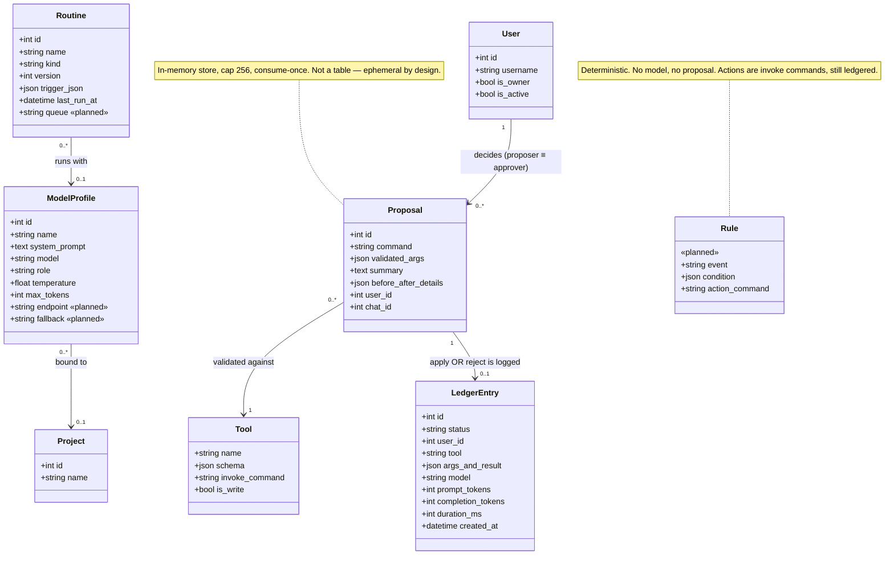
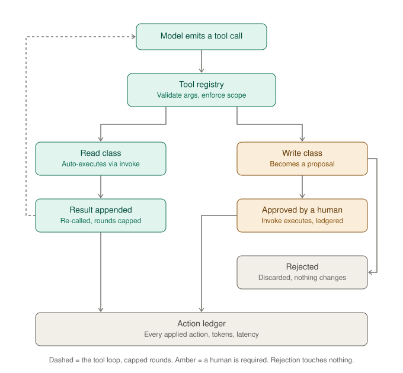
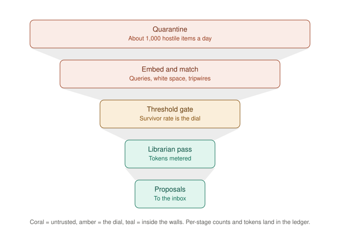
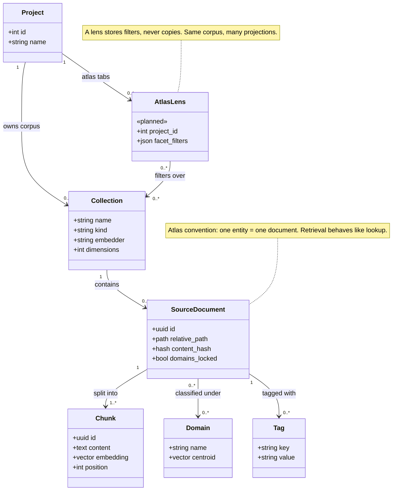

# Ganban — Architecture

> Verified against the code 2026-06-12 and corrected (original was written from design
> reconciliation). These diagrams version with the code — components and fields that are
> **design, not yet built** are explicitly marked `(planned)`; everything unmarked
> exists and is checkable in the repo.

Ganban is an all-Rust, local-first project suite: a Tauri desktop app embedding an axum server
(`/invoke` typed domain RPC, `/chat` SSE pipeline), with supervised local models (Ollama),
per-project RAG corpora (ragrat), and an agent layer whose writes are governed by a
propose → approve → execute gate. The recurring design trick throughout: **decisions stored as
data, enforced by structure** — the gate is a multiplicity, the budget is a threshold, the
sharing model is a filter, the audit trail is a table everything must pass through.

## 1. System overview — trust zones

Coral = untrusted or externally exposed. Amber = human approval required. Nothing untrusted
reaches data except through the gate. **Dashed-context components are planned;
everything else ships today.** Two named pillars live in this planned zone: **Oracle** is the
intake / "get data in" layer (scout → webhook → quarantine → normalize/embed), built first;
**Leonidas** is the **routing funnel / gate** (§4): it screens what Oracle quarantines and routes
the relevant to the right project, **human-gated** on the consequential calls. **Odysseus** is
the **opportunity engine** — it surfaces what matches *no* project. Oracle acquires; Leonidas
routes; Odysseus detects; none auto-writes (everything is a gated proposal).

Multiplicities implied: one server, N clients, N scouts, N tabs, N collections. In embedded
mode the desktop app contains the entire server subgraph in-process; remote mode is the same
diagram over the tailnet.

## 2. Domain core

**Load-bearing facts (as built):**
- A model's write request *cannot exist* as anything but a proposal: `run_tool_loop` routes
  every write-class call through `prepare_write` → `ProposalStore`; there is no code path from
  model output to applied change (`crates/server/src/tools.rs`).
- **Double-submit protection is consume-once semantics, not a data key**: approving takes the
  proposal out of the in-memory store atomically (peek-then-take; re-inserted only on failed
  apply). There is no `idempotency_key` field today — one becomes *necessary* the first time a
  proposal's side effect lives outside Ganban's database (a booking made through an outside service, for
  example).
- Both apply **and** reject are ledgered (status column); rejection applies nothing.
- `proposer ≡ approver` is an enforced invariant with a single `user_id` column — the schema
  cannot express four-eyes approval. [CollaborativeProjects.md](CollaborativeProjects.md) decides whether to change that.
- There is deliberately **no** `Routine → Proposal` edge; as built, routine kind `rundown`
  makes no writes at all. When routines gain write-capable kinds, they go through the same
  gate as chat.
- The ledger's capacity columns (model, prompt/completion tokens, duration) are filled for
  chat turns (summed across tool rounds + the streamed answer, on `chat_messages`) and routine
  runs (on `agent_actions`); interactive approvals carry NULLs — no model ran.

## 3. Tool-call lifecycle

The asymmetry is the argument: the read column is a bounded loop back to the model; the write
column is a dead end only a human can reopen. The rejected state has no outgoing edge — no
cleanup, no compensation logic, genuinely nothing — which is what makes the gate cheap to
trust. Every attack (prompt-injected comments, poisoned feeds) must terminate in that box to
be survived, and by construction it does.

## 4. Leonidas — the routing funnel / gate (planned)

Leonidas is downstream of **Oracle** (the intake layer: scout → webhook → quarantine →
normalize/embed). It reads from quarantine and answers one question — *does this belong to a
project, and which?* — routing the relevant to the right project and holding the rest back.
It's **human-gated**: an association (link a thread/event to a project) is a proposal you
approve, and when the target is ambiguous Leonidas presents the candidates and *you* pick. The
"secretary" is its face. Inbound email is untrusted — Leonidas screens on metadata + a capped,
collapsed snippet; the body never authorizes the association.

**Odysseus** (the opportunity *engine*) sits beside Leonidas, not under it: it consumes what
passes the gate and looks outward for opportunities matching *no* existing project. Where
Leonidas says "none of your projects," Odysseus's territory begins. Neither acquires; neither
auto-writes.

The expensive stage (the librarian model pass) is near the *narrow* end. Everything above it is
CPU arithmetic — embedding, centroid matching, exact-match tripwires — so total burn is set by
the threshold gate's survivor rate. Per-stage counts and tokens land in the ledger; cost is a
dial, not an optimization project. Latency: a single item falls through all stages in seconds
(the bands describe attrition, not waiting), comfortably inside the 2-minute target.
**Leonidas and Odysseus hold zero auto-executing write tools** — every action is a gated
proposal. Detections/associations become proposals; nothing they read can start,
modify, or ingest anything.

## 5. Knowledge model

**Decisions encoded:**
- `AtlasLens.facet_filters` is a query, not foreign keys to documents — staleness is
  *impossible* rather than managed; a project's "picked" countries/vessels/companies cost
  bytes, and every lens is current the moment Atlas learns something new.
- As built, the project↔collection mapping is a **naming convention**, not a `kind` column:
  `collection_name(project_id) = "ganban-<id>"` (`crates/server/src/rag.rs`). ragrat itself is
  collection-name-agnostic, so Atlas (`atlas-*`) needs only new Ganban routes + a non-project
  authz model — search, facets, and ingestion already work identically on any collection.
- Embeddings serve *query matching only*; consumer models eat retrieved text. One well-built
  index serves every model tier. Per-collection embedder choice is allowed; fused search stays
  within same-embedder mounts.

## Invariants (the one-screen version)

1. All agent writes: propose → approve → execute. No exceptions — chat, tabs, **registry tools**
   (data-defined, all five binding kinds), routines, rules-engine actions, Leonidas, Odysseus.
2. Every resolved proposal and routine run is ledgered; model work carries tokens + latency
   (shipped 2026-06-12). The ledger is audit trail and capacity meter.
3. External content — RAG hits, task text, email bodies, tab/connector API responses, **fetched
   web pages**, and (planned) webhook envelopes and feeds — is maximally untrusted and can never
   authorize a write. Egress binding kinds (`mcp`/`http`/`fetch`) are **owner-only** (gated at
   assembly AND execution) and SSRF-guarded; connector secrets are host-only, never returned,
   never synced. See `docs/design/ToolRegistry.md`.
4. (Planned) Inbound external data lands in quarantine; nothing graduates without
   passing Leonidas's funnel.
5. Toolsets are small, project-scope is forced server-side, args are validated server-side.
6. Iteration doctrine, reconciled with the code: the per-item proposal loop (16 rounds,
   deduped) serves interactive-scale batches; batch-args tools own enumeration-scale work
   when it arrives. Don't promise agents bulk ops over hundreds of items until
   those tools exist.
7. The server crate stays free of UI dependencies. Endpoint-per-ModelProfile is the next
   target; today one global Ollama URL — and the desktop supervisor must learn not to clobber
   a remote one.
