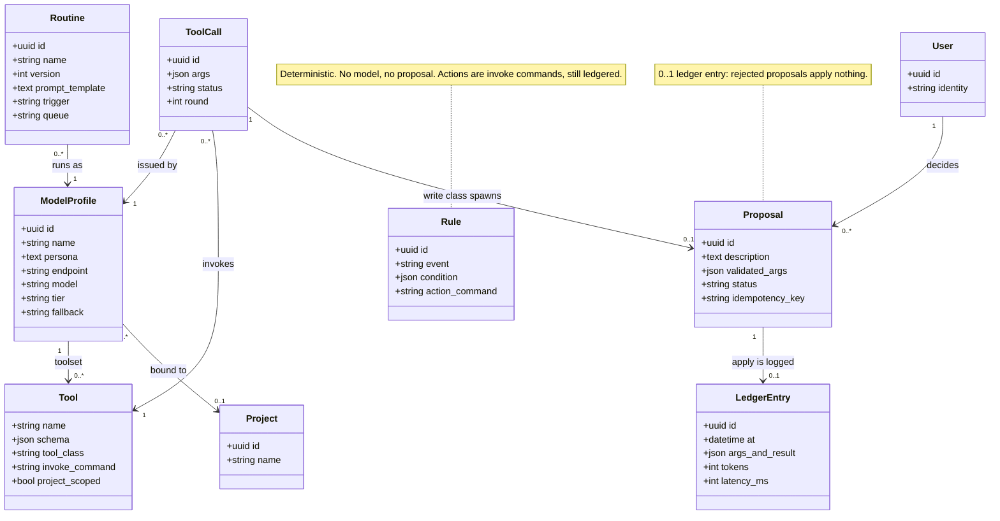

# Domain core — class diagram

Ganban's agent core: how a model proposes, a human decides, and every applied
write lands in an append-only ledger — plus the deterministic (Rule) and scheduled
(Routine) paths that share the same invoke surface.

## What the shape encodes
The recurring trick: **decisions stored as data, enforced by structure.** The gate
is a multiplicity (a write-class `ToolCall` *must* spawn a `Proposal` before a
`LedgerEntry` exists); the audit trail is an append-only table everything passes
through; the sharing model is a filter; the budget is a threshold. These can be
violated only by changing the schema — not by forgetting an `if`.

## Reconciliation with the shipped code (read before trusting a line)
Planning-time draft, ahead of the schema in places:

- **`Proposal.idempotency_key` is not in the schema yet.** It belongs to the
  external-write design (e.g. the Sports/booking "retry can't double-book" guard);
  today's `agent_actions` have no such column.
- **`Routine.queue` (priority class) is not built.** The two-lane scheduler is an
  Leonidas funnel gate — routines run single-queue
  today.
- **`User --> Proposal : decides` understates the approver ≡ proposer invariant.**
  There is one `user_id` column; the schema cannot yet express four-eyes / delegated
  approval (the decider must equal the proposer). Changing that needs a schema +
  `authorize_proposal` change (a documented K deferral).
- **`ModelProfile.tier`** maps to the routing class in practice (`ROUTING_CLASSES`);
  `endpoint` + `fallback` are real.
- **`Rule`** matches the shipped native rules engine (2026-06-13).
