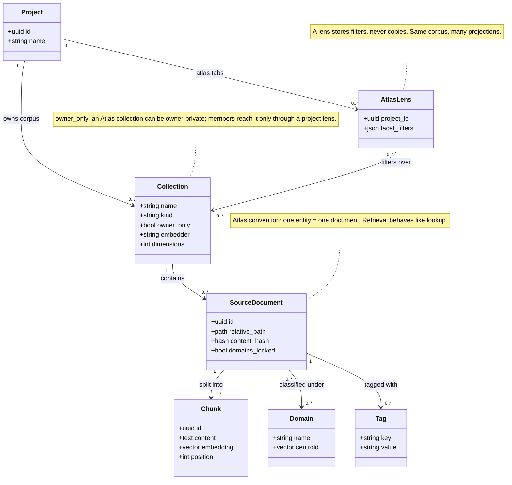

# Knowledge model — class diagram

The corpus/Atlas layer: how documents, chunks, domains and tags relate, and how a
project *projects* shared knowledge through a lens without ever copying it.

## What the shape encodes
- **`AtlasLens.facet_filters` is a JSON blob, not foreign keys to documents.** That
  one attribute is the no-duplication guarantee: a project "picking" Panama, three
  vessels and two companies stores ~40 bytes, and the moment Atlas learns something
  new about Panama every lens filtering for it is already current. Copying documents
  would give N stale copies and a sync problem; lens-as-query makes staleness
  *impossible* rather than managed.
- **`Collection.kind`** — project corpora and Atlas collections are the same idea
  with one discriminator, so search, facets, ingestion and the librarian work
  identically on both. No special Atlas machinery.
- **`Collection.owner_only`** (added 2026-06-14) — an Atlas collection can be kept
  private to the owner; members never see it in the registry or the read routes, and
  it reaches them only as a curated slice through a project's Atlas lens.

## Reconciliation with the shipped code (read before trusting a line)
This was drawn during planning, without the database in view. It is conceptually
right and structurally idealised; the boundaries in the running system:

- **`SourceDocument`, `Chunk`, `Domain`, `Tag` live in ragrat** (the Python index),
  not Ganban's SQLite. Ganban reads `facets.json` / search results; it does not own
  these tables. The boundary runs *through* this diagram.
- **`Collection` is not one table.** Project corpora are the ragrat collection
  `ganban-<project_id>` (a naming convention + project-keyed authz); Atlas
  collections are rows in `atlas_collections` (`crates/core/src/models.rs`). The
  `kind` discriminator is the name prefix, not a column. `RagClient` is
  collection-string-generic, which is what makes "the same class" true in practice.
- **`AtlasLens` is not its own table.** A lens is the Atlas *tab's* `config_json`
  (the tab instance IS the lens), gated by tab enablement — see `atlas.rs` tests.
  The `facet_filters`-not-FKs decision holds exactly as drawn.
