# Ganban FAQ

Short answers to the questions people ask first. Each one links to the guide page with the full steps:
[Getting started](GETTING_STARTED.md), [Phones and pairing](PHONES_AND_PAIRING.md), [Sharing](SHARING.md),
[Updates and backups](UPDATES_AND_BACKUPS.md) and [Troubleshooting](TROUBLESHOOTING.md).

The screenshots use made-up sample data.

**Contents**

1. [What is Ganban? Does it need the cloud or an account?](#1-what-is-ganban-does-it-need-the-cloud-or-an-account)
2. [How do I install it?](#2-how-do-i-install-it)
3. [What happens on first run, and where's my data?](#3-what-happens-on-first-run-and-wheres-my-data)
4. [How do I turn on the AI assistant?](#4-how-do-i-turn-on-the-ai-assistant)
5. [Chat says "connected" but fails.](#5-chat-says-connected-but-fails)
6. [How do I use Ganban from my phone?](#6-how-do-i-use-ganban-from-my-phone)
7. [My phone says "Can't reach your host".](#7-my-phone-says-cant-reach-your-host)
8. [How do I add family or a friend to a project?](#8-how-do-i-add-family-or-a-friend-to-a-project)
9. [How do I send files to someone who doesn't use Ganban?](#9-how-do-i-send-files-to-someone-who-doesnt-use-ganban)
10. [How do updates work?](#10-how-do-updates-work)
11. [How do I back up and restore?](#11-how-do-i-back-up-and-restore)
12. [What are tabs, and how do I turn one on?](#12-what-are-tabs-and-how-do-i-turn-one-on)
13. [Can I build my own tab?](#13-can-i-build-my-own-tab)
14. [Can the AI change my data on its own?](#14-can-the-ai-change-my-data-on-its-own)
15. [How do I change the look?](#15-how-do-i-change-the-look)

---

## 1. What is Ganban? Does it need the cloud or an account?

Ganban is a project and task manager: projects, tasks and a board, events, contacts, files, a timer and reports. It
also has an optional AI assistant that runs on your own computer.

It needs no cloud service and no account. Your data sits in a database file on your computer. Nothing is sent
anywhere unless you set it up yourself, for example a share link or a phone that connects to your computer.

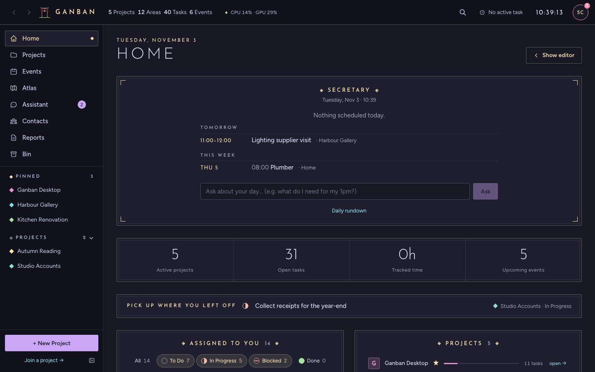

More: [Getting started](GETTING_STARTED.md).

## 2. How do I install it?

Download the installer for your system from the project's GitHub **Releases** page:

- **Mac:** the `.dmg`, for Apple Silicon (M1 and newer). Intel Macs aren't built since 1.0.7; 1.0.6 is the last Intel
  release.
- **Windows:** the `.msi` or `.exe`.
- **Linux:** the `.AppImage` or the `.deb`.
- **Android:** the `.apk`. You only need it to use Ganban on an Android phone ([question 6](#6-how-do-i-use-ganban-from-my-phone)).

The apps aren't signed with a paid developer certificate, so your system may warn you the first time. The steps for
each system are in [Getting started](GETTING_STARTED.md#1-install).

## 3. What happens on first run, and where's my data?

The first time you open the app, it asks how this computer should run:

- **Use this machine:** everything stays on this computer. Pick this if you're starting out.
- **Join a server:** connect to someone else's Ganban, using an invite link they sent you.

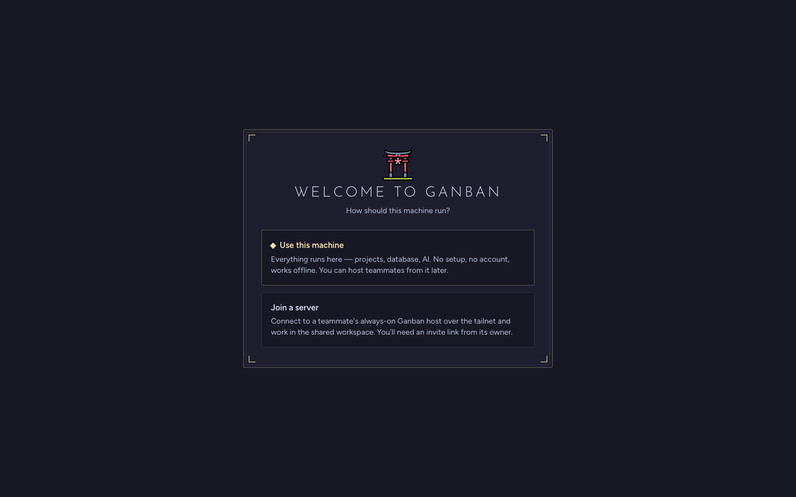

Your data lives in one folder:

| System | Folder |
|---|---|
| macOS | `~/Library/Application Support/com.scs.gansty/` |
| Windows | `%APPDATA%\com.scs.gansty\` |
| Linux | `~/.local/share/com.scs.gansty/` |

The database is `gansty.db`, and uploaded files go in `shared/`. More:
[Getting started](GETTING_STARTED.md#2-first-run).

## 4. How do I turn on the AI assistant?

The assistant is optional. Everything else works without it.

1. Install [Ollama](https://ollama.com), the free program that runs AI models on your computer.
2. In Ganban, open **Settings → AI Engines**. The desktop app finds Ollama and starts it with **Start engines**.
3. Open **Settings → Models**, type a model name such as `llama3.1:8b` under **Pull a model**, and press **Pull**.
   Then pick it as the **Chat model** and press **Save**.

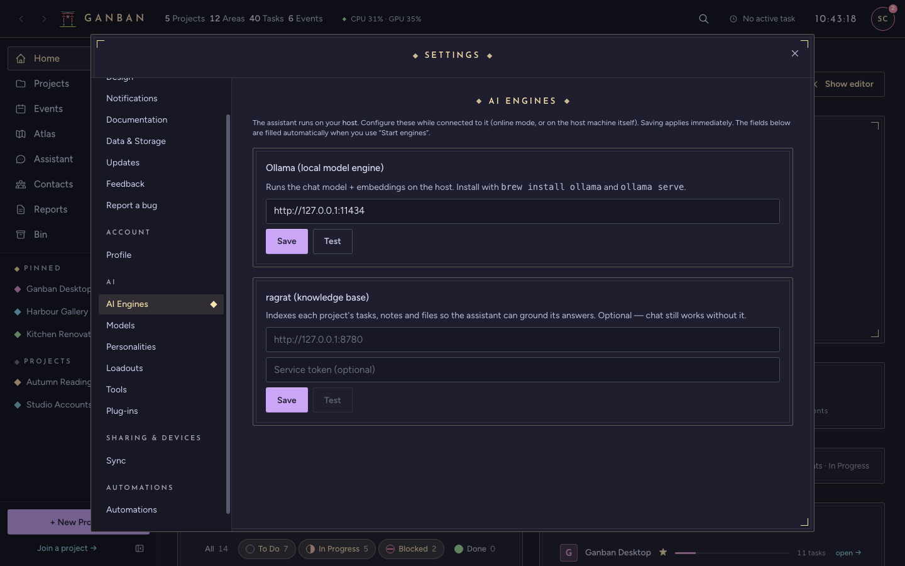

The second card, **ragrat (knowledge base)**, is for a document index that's coming later. Leave it empty. Until then,
Atlas and the AI overview say "not set up".

## 5. Chat says "connected" but fails.

"Connected" means Ganban can reach Ollama. Chat also needs a model, and usually the chosen model hasn't been
downloaded.

Open **Settings → Models**. If the **Chat model** list says "No models — pull one below", pull one (question 4) and
pick it. If you choose no model, Ganban asks Ollama for `llama3.1:8b`, so either pull that one or pick another.

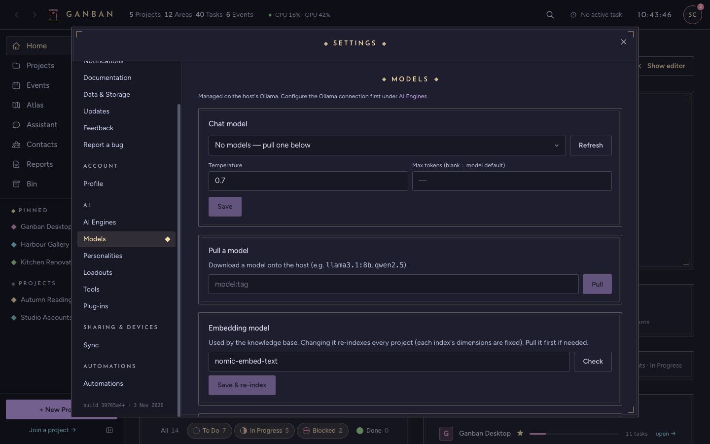

More: [Troubleshooting](TROUBLESHOOTING.md#the-assistant).

## 6. How do I use Ganban from my phone?

Your phone connects to the computer that holds your data. That computer is the **host**. Phones reach it over
[Tailscale](https://tailscale.com), a free private network between your own devices, or over the same home network.

1. On the host's desktop app: **Settings → Sync → Host this device → Start**, then **Pair a phone**. It shows a QR
   code and a link.
2. On an **Android** phone with the Ganban app: scan the QR code.
3. On an **iPhone**, or any phone without the app: open the link in the browser. Add it to the Home Screen if you like.

Already signed in on one device? Pair the next one from **Settings → Profile → Your devices → Pair another device**.

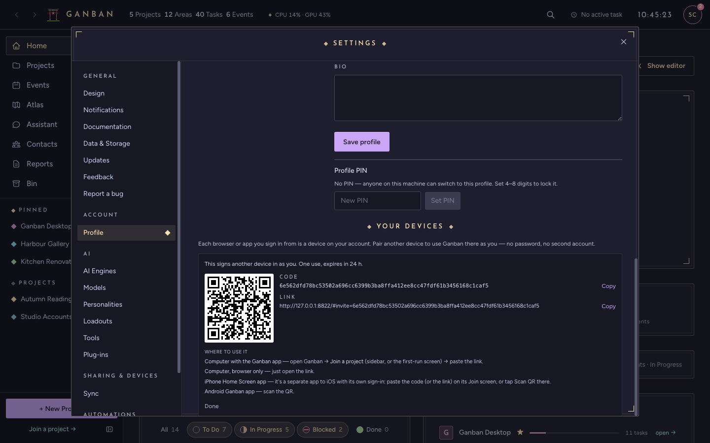

On the phone, the Join screen takes the code, the link, or a scan of the QR code:

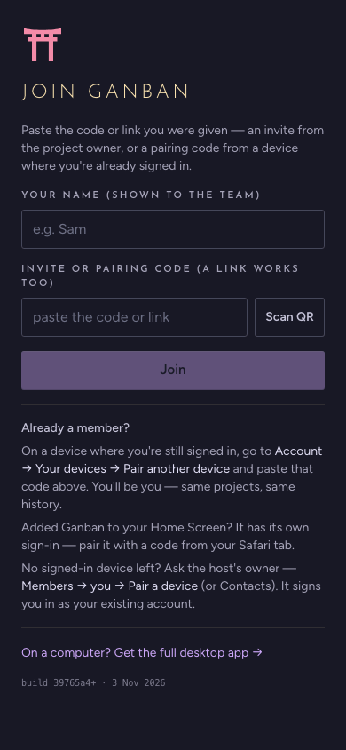

More: [Phones and pairing](PHONES_AND_PAIRING.md).

## 7. My phone says "Can't reach your host".

Your phone is still paired, so you don't need to pair it again. It just can't reach the host right now. Usually:

- the host computer is asleep, switched off, or Ganban isn't running on it;
- the phone is off the network: Tailscale is off, or you've left the home Wi-Fi.

Wake the host or turn Tailscale on, then press **Retry**.

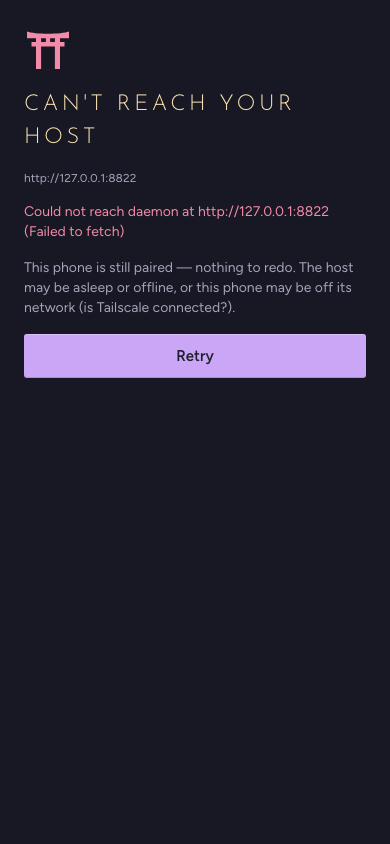

More: [Troubleshooting](TROUBLESHOOTING.md#phones).

## 8. How do I add family or a friend to a project?

Open the project, then its **Members** tab.

- **Someone already on your Ganban:** pick them under **Add a member**, choose a role, and press **Add**.
- **Someone new:** press **Invite by link…** and send them the link, or let them scan the QR code. The link works
  once and expires after about 24 hours.

They need to reach your host, just like your own phone does (question 6). They only see the projects you add them to.

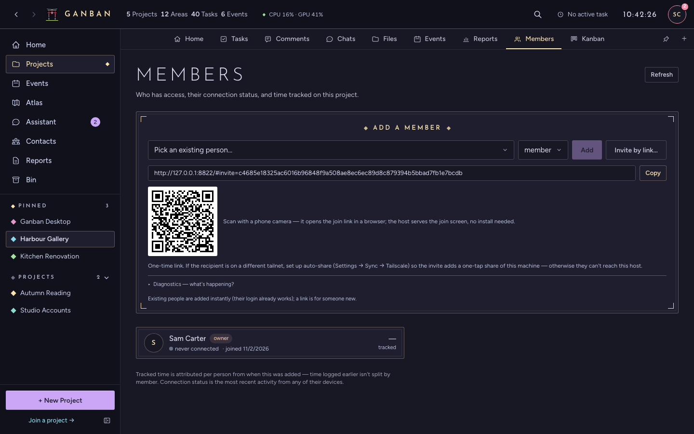

More: [Phones and pairing](PHONES_AND_PAIRING.md#invite-someone-to-a-project).

## 9. How do I send files to someone who doesn't use Ganban?

Make a **share link**. The other person gets a web page with the files and a **Download all (.zip)** button. They
don't need an account or the app.

1. Open the project's **Files** tab (or a task's files) and press **Share link…**.
2. Tick the files, pick when the link expires, and add a password if you want one.
3. Press **Create link**, then **Copy**, and send it.

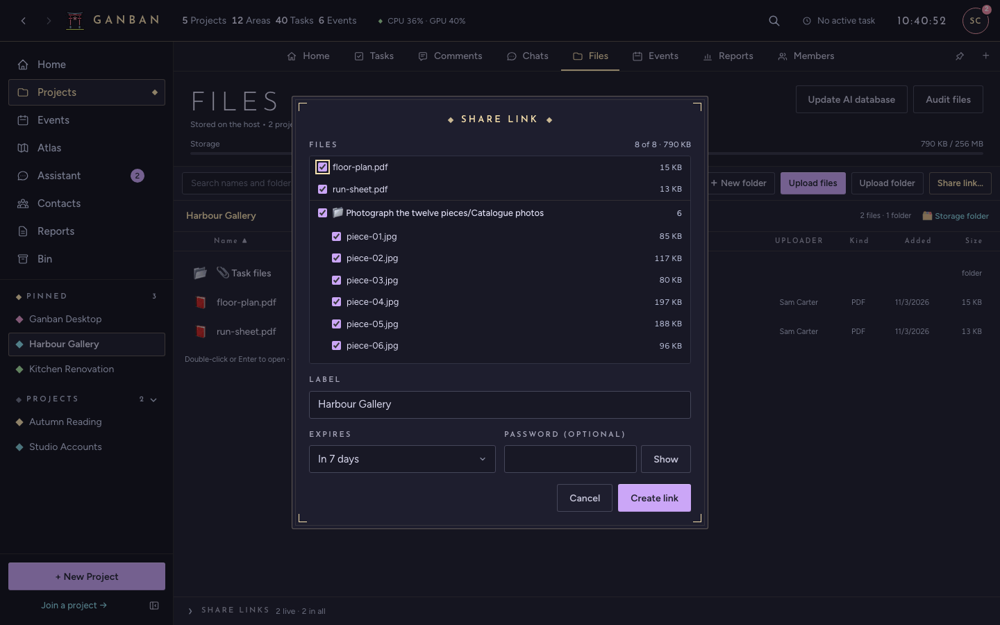

The person you send it to sees this:

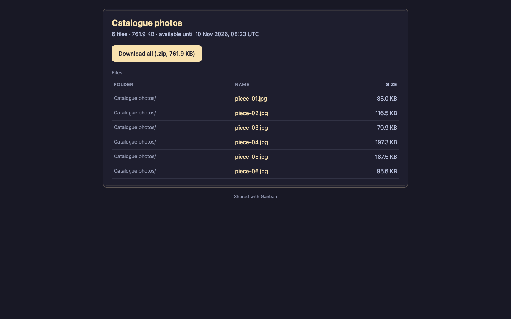

Share links only work from outside your network once the host has a **share door** set up. More:
[Sharing](SHARING.md).

## 10. How do updates work?

That depends on where your app came from.

- **Downloaded from GitHub's Releases page:** the app checks GitHub at launch and every 6 hours, downloads a new
  version in the background and shows **Update ready · Restart** (Android: **Update available**). Your data stays
  where it is. **Settings → Updates → Check GitHub for new versions** turns the checks off; then you download new
  versions by hand. Version 1.0.1 and older need one manual install first.
- **Built by your host:** the host builds the apps when it updates, and they never ask GitHub. Desktop apps download the new version in the background
  and show **Update ready · Restart** in the top bar. Android phones show **Update available**. Browsers show
  **A newer Ganban is on the host · Reload**.

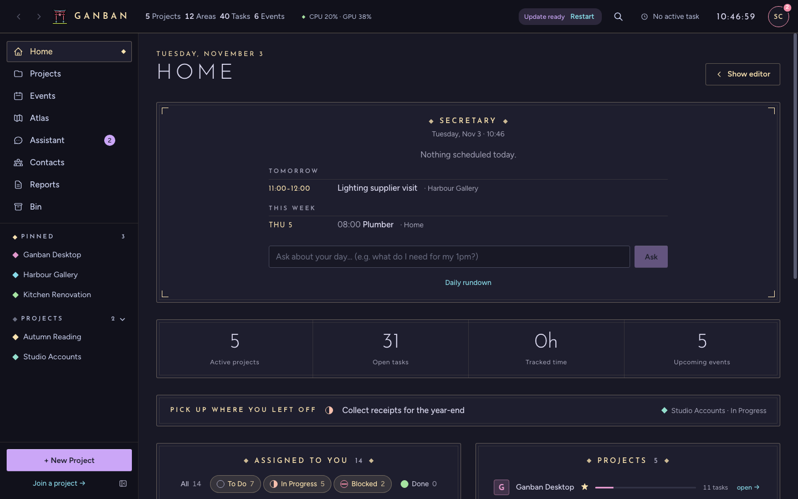

The host's owner can start an update from **Settings → Updates → Update the server**. More:
[Updates and backups](UPDATES_AND_BACKUPS.md).

## 11. How do I back up and restore?

On the desktop app, **Settings → Data & Storage → Backup & restore → Export** saves your whole database to one file.
**Import** puts an export back. It replaces the current data, and makes a backup of it first.

To back up by hand, quit Ganban and copy the data folder (question 3), including `shared/`, which holds your files.

A host that runs as a service backs itself up every night and before every update. To take a backup now, from the
folder where you installed Ganban's source:

```bash
ops/backup.sh            # keeps the newest 14
ls "<data folder>/backups/"
```

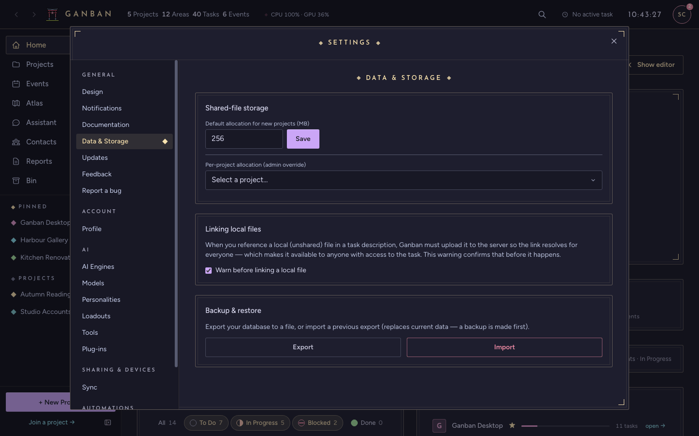

More: [Updates and backups](UPDATES_AND_BACKUPS.md#backups).

## 12. What are tabs, and how do I turn one on?

Each project has a row of tabs: Home, Tasks, Comments, Chats, Files, Events, Reports and Members. You can add extra
tool tabs to a project, such as a Kanban board, PDF Studio, Email or Quizzes.

Open the project, press **＋** at the right end of the tab bar, and tick the tabs you want. They're turned on for
that project only.

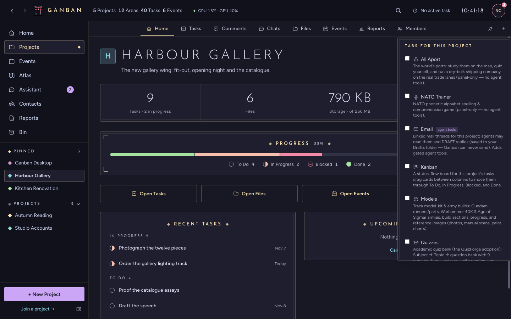

## 13. Can I build my own tab?

Yes, if you can write a little React and Rust. Tabs are compiled into the app, so you build Ganban from source with
your tab included. There's no plugin store and nothing to install separately.

The [tab tutorial](../dev/TAB_TUTORIAL.md) builds a small "Hello" tab step by step. The rules a tab must follow are
in [TAB_SPEC.md](../dev/TAB_SPEC.md). Here is a built-in tab, Kanban, after it's been turned on:

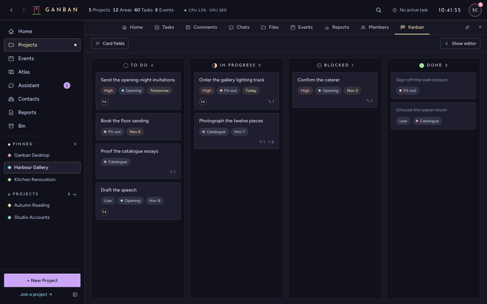

## 14. Can the AI change my data on its own?

No. The assistant can only change things after you say yes.

- **Tools are off by default.** In a chat, the **Tools** switch below the message box lets the assistant look things
  up in that one project. It turns off again for every new chat.
- **Changes are proposals.** When the assistant wants to add or change a task, you get a card with **Approve** and
  **Dismiss**. Nothing changes until you approve it.
- **Everything is recorded.** **Assistant → Activity** lists the proposals waiting for you, with the before and after
  of each change, and keeps a record of everything that was approved, rejected or run.

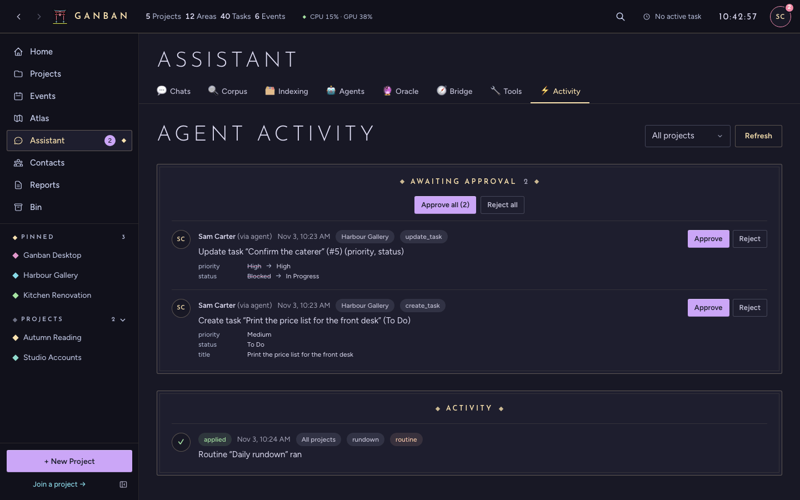

## 15. How do I change the look?

Open **Settings → Design** and pick a theme. Catppuccin Mocha is the dark default, and Catppuccin Latte is the light
one. Under **Interface** you can also switch between the desktop and the touch layout.

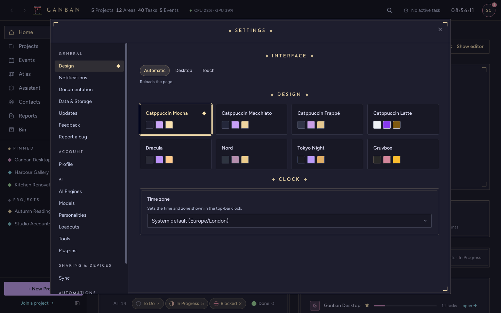

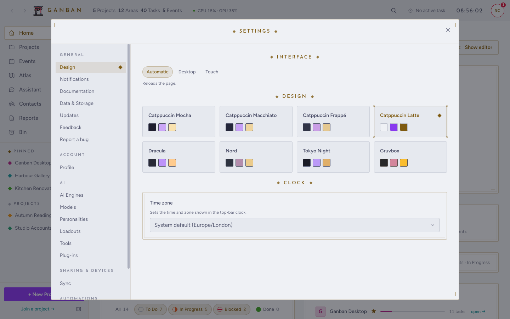
