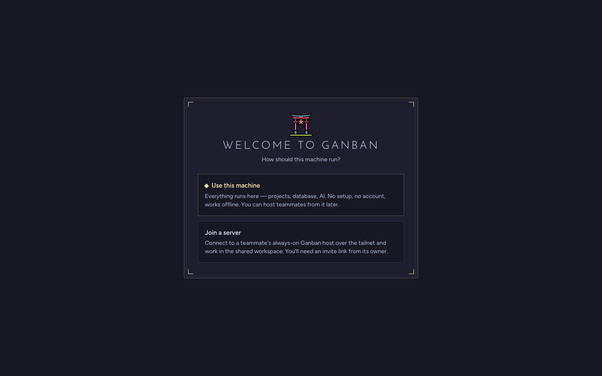
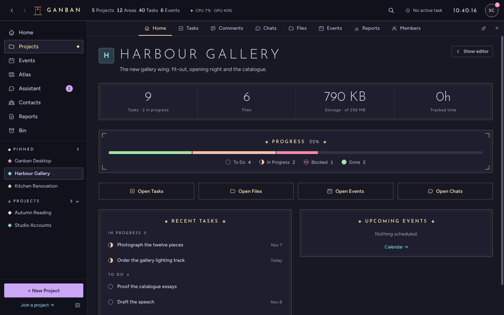
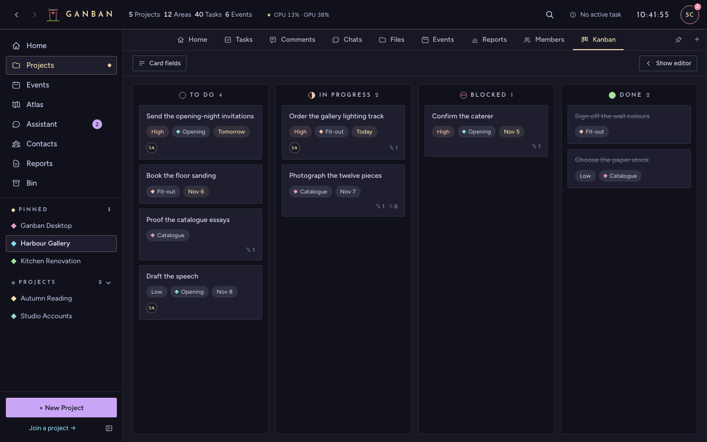

# Getting started

This page takes you from download to your first task. It takes about five minutes. Questions not covered here are
in the [FAQ](FAQ.md).

## 1. Install

Download the installer for your system from the project's GitHub **Releases** page, then install it as below.

The apps aren't signed with a paid developer certificate, so each system warns you the first time. That's expected.

### macOS

1. Open the `.dmg` (for Apple Silicon Macs, M1 and newer) and drag **Ganban** into **Applications**.
2. Open Ganban. If macOS says it "can't be opened" or "is damaged", open **Terminal** and run this once:

   ```bash
   xattr -cr /Applications/Ganban.app
   ```

   It removes the download quarantine flag. Then open Ganban again.

### Windows

1. Run the `.msi` or the `.exe` installer.
2. If Windows SmartScreen says it "protected your PC", choose **More info → Run anyway**.

### Linux

- **AppImage:** make it executable (`chmod +x Ganban_*.AppImage`) and run it.
- **Debian or Ubuntu:** `sudo apt install ./Ganban_*.deb`.

On other distributions, use the AppImage.

### Phones

Phones don't run Ganban on their own: they connect to a computer that does. See
[Phones and pairing](PHONES_AND_PAIRING.md).

## 2. First run

The first time Ganban opens, it asks how this computer should run.



- **Use this machine:** your projects and the database live on this computer. It works offline. Choose this unless
  someone has invited you to their Ganban.
- **Join a server:** paste the invite link someone sent you, and you work in their Ganban instead.

You can still let your phone or other people in later. This computer then becomes the **host**.

### Where your data lives

Everything is in one folder on this computer:

| System | Folder |
|---|---|
| macOS | `~/Library/Application Support/com.scs.gansty/` |
| Windows | `%APPDATA%\com.scs.gansty\` |
| Linux | `~/.local/share/com.scs.gansty/` |

- `gansty.db` is the database: projects, tasks, events, contacts and settings.
- `shared/` holds the files you upload.
- `logs/` holds the app's logs, which help when you report a bug.

Uninstalling the app leaves this folder alone. To back it up, see [Updates and backups](UPDATES_AND_BACKUPS.md#backups).

## 3. Your first project

1. Press **+ New Project** at the bottom of the left sidebar.
2. Type its name and press **Create**.
3. Double-click the project in the sidebar to open it. (A single click filters the Home screen to that project.)

A project opens on its own **Home** tab, with its other tabs along the top.



## 4. Your first task

1. In the project, open the **Tasks** tab.
2. Press the **＋** button next to **Filter & sort**.
3. Type a title. Set a status (To Do, In Progress, Blocked or Done), a priority and a deadline if you want them, and save.

Click a task to open it. There you can write notes, add comments and files, link contacts, and start the timer.
Turn on the **Kanban** tab (**＋** at the right end of the tab bar) to drag tasks between columns.



## What next

- **Turn on the AI assistant** (optional): [FAQ 4](FAQ.md#4-how-do-i-turn-on-the-ai-assistant).
- **Use it from your phone:** [Phones and pairing](PHONES_AND_PAIRING.md).
- **Send files to someone:** [Sharing](SHARING.md).
- **Keep it updated and backed up:** [Updates and backups](UPDATES_AND_BACKUPS.md).
- **Something's wrong:** [Troubleshooting](TROUBLESHOOTING.md).
