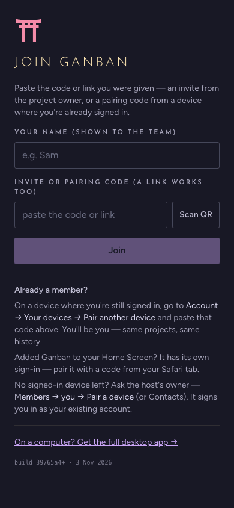
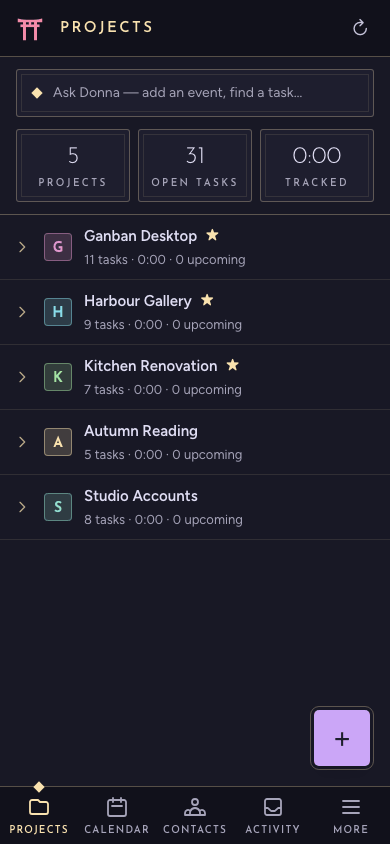
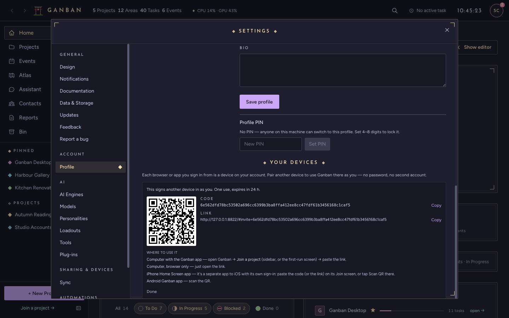
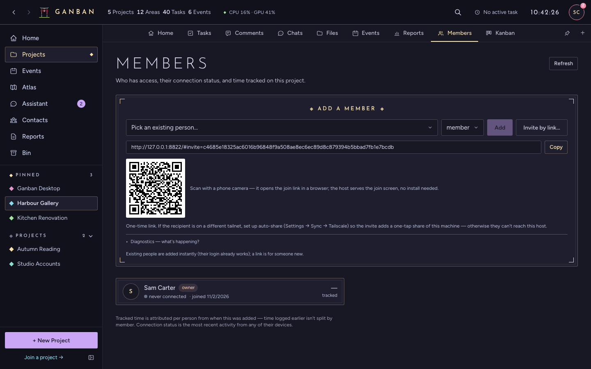

# Phones and pairing

Use Ganban on your phone, on a second computer, or with family and friends. Every device connects to one computer
that keeps the data: the **host**.

## What you need

- **A host.** The desktop app on a computer that stays on works. For a host that always answers, even when nobody
  is logged in, set up a headless server instead ([SELF_HOSTING.md](../host/SELF_HOSTING.md)).
- **A way to reach it.** On the same home network, devices reach the host directly. From anywhere else, install
  [Tailscale](https://tailscale.com) on the host and on each device. Tailscale is a free private network between
  your own devices, and Ganban's server should never be opened to the public internet.

## Pair your phone

1. On the host's desktop app, open **Settings → Sync → Host this device** and press **Start**. It shows the host's
   addresses under **Reachable at**.
2. Press **Pair a phone**. A QR code and a **Copy invite link** button appear.
3. On the phone:
   - **Android:** install the Ganban `.apk` (from the Releases page, or from the host's `/download` page when its
     owner has put it there), open it, and scan the QR code.
   - **iPhone, or any phone without the app:** open the link in the browser. The browser gets the full app, laid out
     for touch.

The phone's Join screen also takes the code or the link pasted in, or **Scan QR**, which reads the code with the
camera:

Once it's paired, the phone shows your projects:

Pairing links work once and expire after about 24 hours. A paired device stays signed in until you remove it.

### iPhone: add it to the Home Screen

In Safari, **Share → Add to Home Screen** gives Ganban its own icon. iOS treats the Home Screen app as a separate
device with its own sign-in, so pair it once more: in the Safari tab, open **Account → Your devices → Pair another
device**, copy the code, and paste it on the Home Screen app's Join screen.

## Add another device of your own

On any device where you're already signed in, open **Settings → Profile → Your devices** (on a phone: **More →
Account → Your devices**) and press **Pair another device**. You get a code, a link and a QR code that sign the new
device in as you, with the same projects and history.

- **A computer with the Ganban app:** choose **Join a server** on the first-run screen (or **Join a project** in the
  sidebar) and paste the link. Copy the link across. Don't click it on that computer, because that opens a browser
  tab instead of the app.
- **A computer with just a browser:** open the link.
- **A phone:** scan the QR code, or paste the code on the Join screen.

The same list shows every device on your account. **Remove** one you've lost, and it's signed out on its next request.

## Invite someone to a project

1. Open the project and its **Members** tab.
2. Someone already on your host: pick them under **Add a member**, choose **member** or **admin**, and press **Add**.
3. Someone new: press **Invite by link…** and send them the link, or let them scan the QR code.

They join on whichever device they open the link on. They see only the projects you add them to. If they're not on
your home network, they need Tailscale too. The invite can include a Tailscale share of just the host, which they
accept with their own Tailscale account; your host's owner sets that up under **Settings → Sync → Tailscale**.

**Someone lost every device they were signed in on?** Don't invite them again; that would make a second account.
As the host's owner, open **Members → the person → Pair a device…** (or **Contacts → the person → Pair a new
device**) and send them that code.

## When it doesn't connect

- **"Can't reach your host":** the phone is still paired. Wake the host, or turn on Tailscale, then **Retry**.
- **"That doesn't look like a Ganban link":** paste the whole link or code you were sent.
- **The link was already used, or it's more than a day old:** ask for a new one.

More in [Troubleshooting](TROUBLESHOOTING.md#phones). Back to the [FAQ](FAQ.md).
