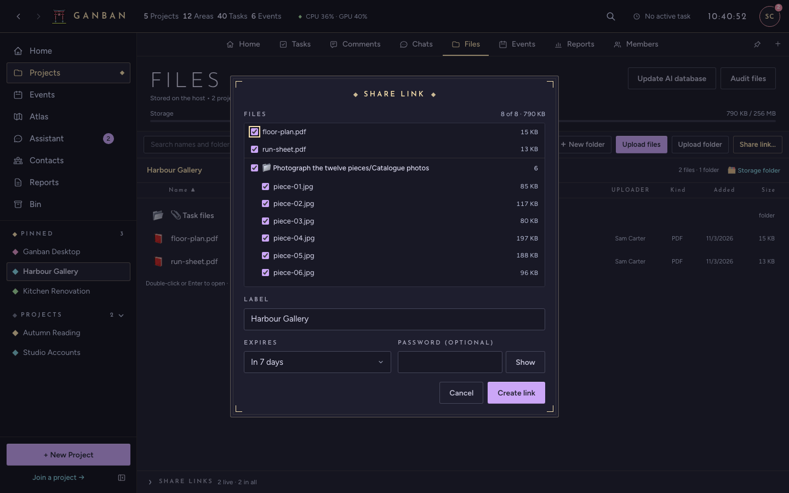
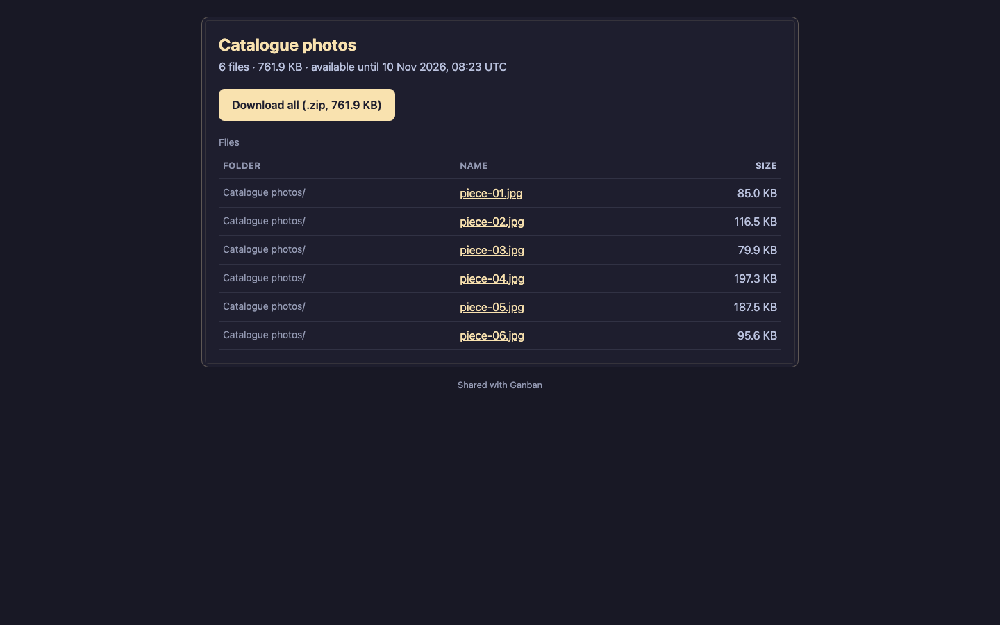
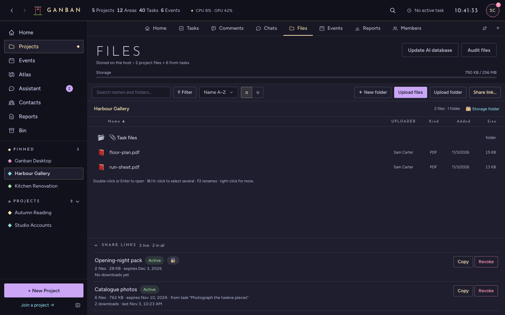

# Sharing files with a link

A **share link** sends files to someone who doesn't use Ganban: a client, a printer, a relative. They open a web page
and download the files. They need no account and no app.

## Make a link

You can share from a whole project or from one task. You need to be the project's admin or the host's owner.

**From a project:**

1. Open the project's **Files** tab and press **Share link…**. To share only some files, select them first (⌘- or
   Shift-click), or right-click a folder and choose **Share link…**.
2. Tick the files to include. The list has the project's own files and its tasks' files; each task's files sit in a
   folder named after the task.
3. Check the **Label**. It's the title the other person sees.
4. Pick when it **Expires**: in 1 day, 7 days (the default), 30 days, or never.
5. Add a **Password** if you want one. Send it separately from the link.
6. Press **Create link**, then **Copy**, and send the link.

**From a task:** open the task's files and press **Share link…** under them. It works the same way, with that task's
files.

A big folder takes a few seconds per gigabyte to prepare. The link shows **Preparing** until it's ready.

## What the other person sees

A plain page with the file list, a **Download all (.zip)** button and a link for each file. A password-protected
link asks for the password first. If their connection drops during a big download, it resumes where it stopped.

When a link has expired or been revoked, the page says "This link isn't available".

## Keep track of your links

The **Share links** list at the bottom of the project's Files tab (and under a task's files) shows each link with its
status, the file count, when it expires, how many times it was downloaded, and when last.

- **Copy** copies the link again.
- **Revoke** turns it off at once. Anyone who opens it afterwards gets "This link isn't available".

## If a link doesn't work

- **"This host has no public share door yet".** The host hasn't been set up to publish share links, so links can be
  made but can't be opened from outside your network. The host's owner sets up the share door once:
  [SELF_HOSTING.md § Share links](../host/SELF_HOSTING.md#share-links).
- **Some files can't be shared.** Files that exist only on someone's own device, not on the host, can't go in a link.
  Upload them to the host first; the dialog says how many there are.
- **The other person can't open it.** Check the link hasn't expired or been revoked in the **Share links** list, and
  that they have the password.

More in [Troubleshooting](TROUBLESHOOTING.md). Back to the [FAQ](FAQ.md).
