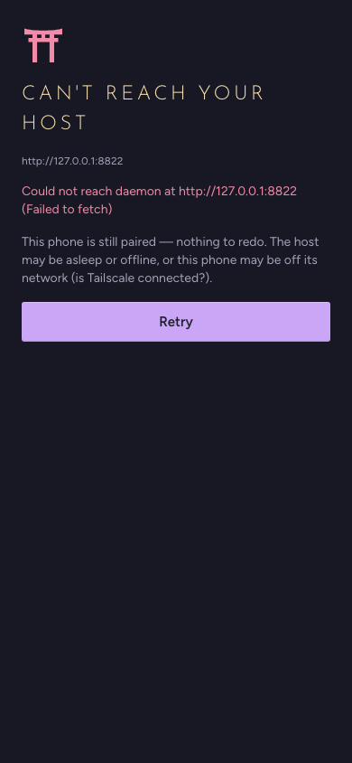

# Troubleshooting

Find the symptom, then try the fix. Problems with running a headless host (the service, ports, Tailscale setup) are in
[SELF_HOSTING.md § Troubleshooting](../host/SELF_HOSTING.md#troubleshooting).

## Installing and starting

- **macOS says Ganban "can't be opened" or "is damaged".** The app isn't signed with a paid certificate. Run
  `xattr -cr /Applications/Ganban.app` in Terminal once, then open it again.
- **Windows SmartScreen blocks the installer.** Choose **More info → Run anyway**.
- **The AppImage won't start on Linux.** Make it executable: `chmod +x Ganban_*.AppImage`. If it stops with
  `Could not create default EGL display: EGL_BAD_PARAMETER`, it's an AppImage from before this was fixed: download
  the latest release.
- **I chose the wrong option on the first-run screen.** If you picked **Use this machine** but meant to join
  someone, press **Join a project** at the bottom of the sidebar and paste their link.

## The assistant

- **"Connected", but chat fails.** No chat model is downloaded. Open **Settings → Models**, pull a model (for example
  `llama3.1:8b`) and pick it as the **Chat model**. See [FAQ 5](FAQ.md#5-chat-says-connected-but-fails).
- **Chat says the engine isn't running.** Ollama isn't running. Open **Settings → AI Engines** on the host and press
  **Start engines**, or start Ollama yourself.
- **Atlas or the AI overview says "not set up".** They need the knowledge base (ragrat), which is coming later.
  Everything else works without it.
- **The assistant can't see my tasks.** Turn on **Tools** below the message box. It's off in every new chat.
- **The assistant's change didn't happen.** Changes wait for you. Approve them on the card in the chat, or in
  **Assistant → Activity**. See [FAQ 14](FAQ.md#14-can-the-ai-change-my-data-on-its-own).
- **AI settings I saved didn't reach the host.** You saved them on a desktop that runs on its own data. Save them on
  the host, or join the host first ([Phones and pairing](PHONES_AND_PAIRING.md#add-another-device-of-your-own)).

## Phones

- **"Can't reach your host"** (in a browser: "Can't reach the host"). The phone is still paired, so don't pair it again. The host is asleep or offline, or
  the phone is off the network (Tailscale off, or away from home Wi-Fi). Fix that and press **Retry**.

  

- **The phone says it was signed out by the host.** Someone removed this device. Pair it again with a new code.
- **The iPhone Home Screen app opens on the Join screen, but Safari works.** iOS gives the Home Screen app its own
  sign-in. Pair it once: in Safari, **Account → Your devices → Pair another device**, then paste the code in the Home
  Screen app.
- **The pairing link says it was already used or has expired.** Links work once, for about 24 hours. Ask for a new one.
- **The phone doesn't show something it should.** It may be running an old version. Compare the build at the bottom of
  **More → Settings** with the host's. Reload when the banner **A newer Ganban is on the host** appears, or close and
  reopen the app.
- **I lost my phone.** On another signed-in device, open **Settings → Profile → Your devices** and **Remove** it. If you
  have no signed-in device left, ask the host's owner for a new code (**Members → you → Pair a device…**).

## Sharing

- **"This host has no public share door yet".** Links can be made, but nobody outside your network can open them until
  the host's owner sets up the share door ([SELF_HOSTING.md § Share links](../host/SELF_HOSTING.md#share-links)).
- **"This link isn't available".** The link has expired or been revoked. Make a new one.
- **Some files can't be added to a link.** They're only on someone's device. Upload them to the host first.

More in [Sharing](SHARING.md).

## Updates

- **Settings → Updates says "None yet" for the host's desktop build.** The host hasn't built the apps yet. It does that
  when it updates. On a single computer with no host, update from the Releases page.
- **The Android update fails to install.** Android only installs an update signed with the same key. If your Ganban
  came from somewhere else (an older build, or the Releases page), uninstall it once, install the host's app, and
  pair again.
- **The desktop app shows "Update failed".** Press **Retry**. If it keeps failing, install the new version by hand,
  from the Releases page or from the host's `/download` page when its owner has put one there.

More in [Updates and backups](UPDATES_AND_BACKUPS.md).

## Still stuck?

**Settings → Report a bug** collects the app's logs and details for a bug report. Back to the [FAQ](FAQ.md).
