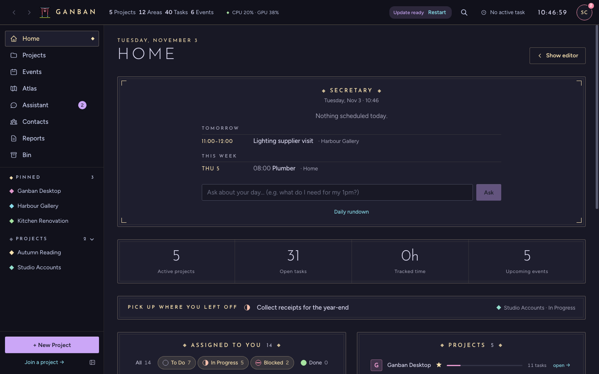
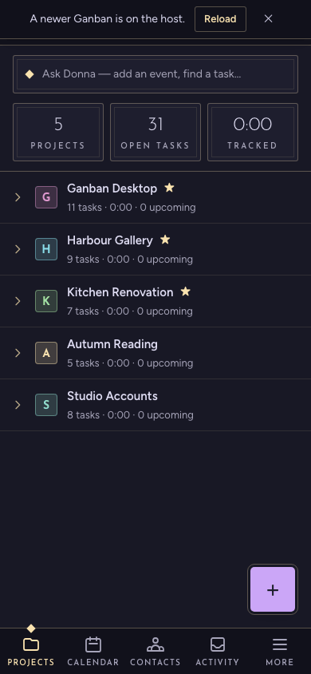
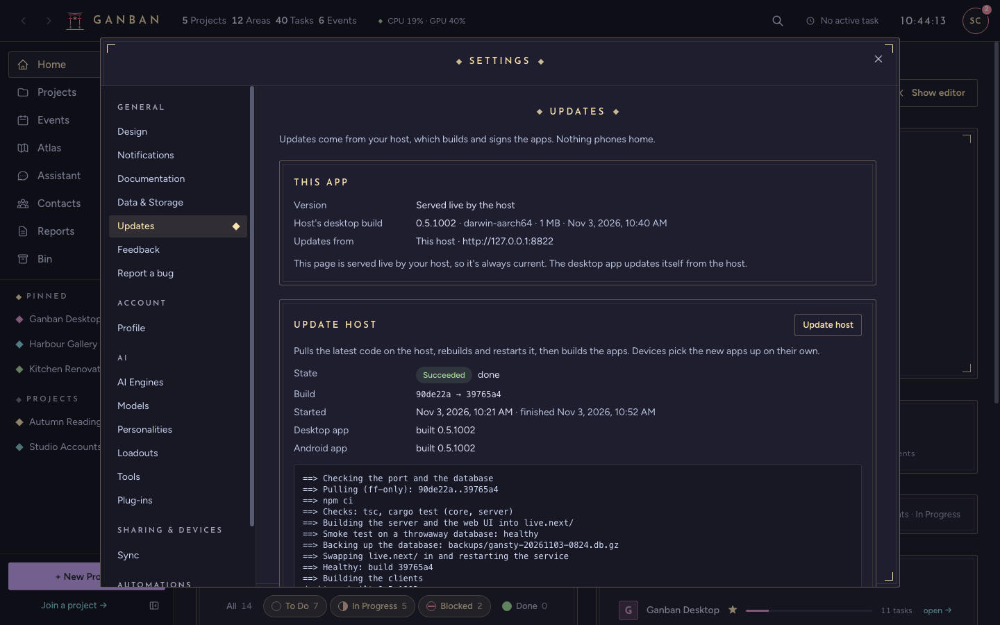
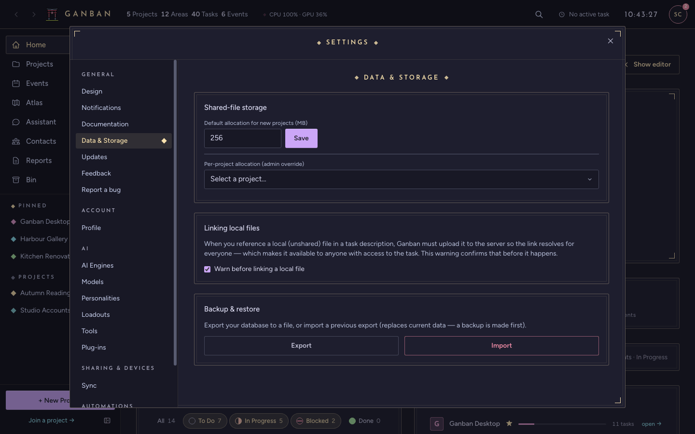

# Updates and backups

How to keep Ganban current, and how to keep a copy of your data.

## Updates

How Ganban updates depends on where your app came from: GitHub's Releases page, or your host.

### Apps downloaded from GitHub

An app you downloaded from the project's GitHub **Releases** page updates itself from there:

- **Desktop app:** it checks GitHub when it starts, every 6 hours, and when you open **Settings → Updates**. A new
  version downloads in the background, then **Update ready · Restart** appears in the top bar. Press **Restart**.
- **Android app:** it shows **Update available**. Tap **Update**, wait for the download, and answer Android's install
  prompt, as below.

To check, the app asks github.com for the latest release, without an account. GitHub sees your IP address. To turn
it off, open **Settings → Updates** (on a phone, **Settings → App update**) and switch off **Check GitHub for new
versions**. Then the app never contacts GitHub, and you update by hand: download the new version from the Releases
page and install it over the old one, as in [Getting started](GETTING_STARTED.md#1-install). Your data folder isn't
touched. To be safe, [export a backup](#backups) first.

Version 1.0.1 and older can't update themselves: install the next version by hand once.

### Apps you built yourself

Download or build the new version and install it over the old one. A build you made with `npm run tauri build`
doesn't update itself.

### With a host

Apps your host built update from the host, never from GitHub. The host updates first, then builds new apps for its devices. Each device then updates itself from the host, not from
the internet:

- **Desktop app:** it checks the host when it starts, every 6 hours, and when you open **Settings → Updates**. A
  new version downloads in the background. When it's ready, **Update ready · Restart** appears in the top bar.
  Press **Restart**: it saves the task you have open and restarts on the new version.

  

- **Android app:** it shows **Update available**. Tap **Update**, wait for the download, and answer Android's install
  prompt. The first time, Android asks you to allow installs from Ganban: turn on **Allow from this source** and go
  back.
- **A browser or an iPhone Home Screen app:** it loads the new version from the host. If a page was open during the
  update, a banner says **A newer Ganban is on the host** with **Reload**.

  

### Updating the host

The host's owner opens **Settings → Updates** on the host and presses **Update the server**. The card shows each step
and a live log. It fetches the latest code, checks and builds it, backs up the database, restarts the server and then,
if the host builds them, builds the desktop and Android apps. Apps downloaded from GitHub Releases update from GitHub
instead. If the new server doesn't start, the update rolls back by itself.



**Update the server** needs a host set up as a service; see
[SELF_HOSTING.md § Updating the host](../host/SELF_HOSTING.md#part-6-updating-the-host). The same page explains how the
host builds and signs the apps.

**Which version am I running?** The bottom of the Settings list shows `build <code> · <date>`. On a phone it's at the
bottom of **More → Settings**, and on the Join screen.

## Backups

### Desktop app

**Settings → Data & Storage → Backup & restore:**

- **Export** saves the whole database to one file you choose, for example `ganban-backup.db`. Keep it somewhere
  other than this computer.
- **Import** replaces the current data with an export. Ganban backs up the current data first, then asks you to
  restart.



An export holds the database, not the uploaded files. For a complete copy, quit Ganban and copy the whole data folder,
including `shared/`:

| System | Data folder |
|---|---|
| macOS | `~/Library/Application Support/com.scs.gansty/` |
| Windows | `%APPDATA%\com.scs.gansty\` |
| Linux | `~/.local/share/com.scs.gansty/` |

To restore a copy, quit Ganban, put the folder back, and start Ganban again.

### A host running as a service

It backs itself up every night and before every update, keeping the newest 14 copies in `backups/` in its data folder.
Take one by hand at any time:

```bash
cd <your Ganban folder>
ops/backup.sh
```

Back up `shared/` with your usual backup tool too. The restore steps are in
[SELF_HOSTING.md § Backups and restore](../host/SELF_HOSTING.md#part-7-backups-and-restore).

Back to the [FAQ](FAQ.md).
